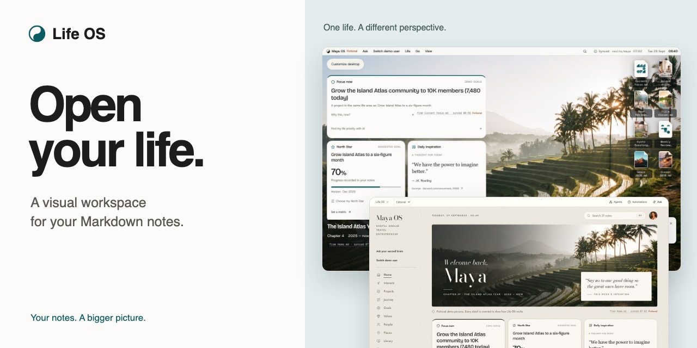
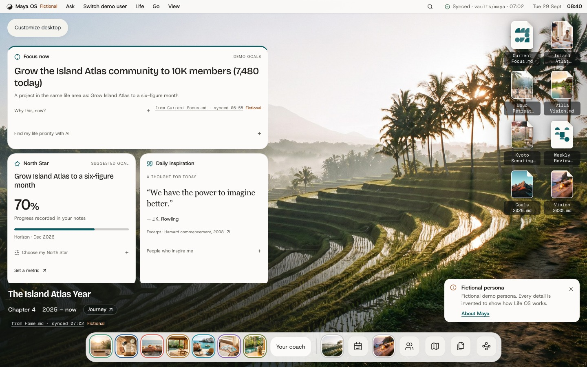
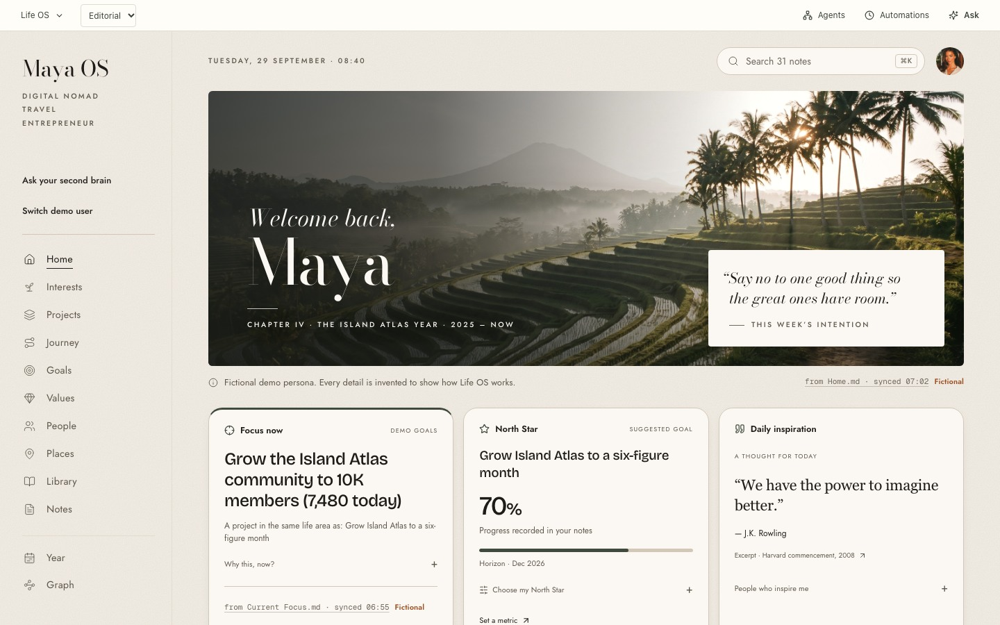

  

# Life OS

**The Markdown notes you already keep, as a visual operating system for your life.**

Bring today's priorities, projects, people and longer-term goals into one picture. Life OS adds a visual layer to your notes, with different views for different ways of thinking.

**[Try the browser preview](https://open-your-life.vercel.app/app/)** · [Architecture](docs/TECHNICAL-OVERVIEW.md) · [Run the checks](docs/VALIDATION.md) · [Release status](#desktop-preview)

Explore a demo life with nothing to install. This repository includes runnable browser checks, sample notes and release information. Application source remains private.

Built by [Megan (@megandmartin)](https://github.com/megandmartin): product concept, interface design, implementation and testing. Development and review are AI-assisted.

## See the day. Keep the bigger picture.

- **Know what matters now.** Bring your current focus, projects and goals into view.
- **Follow the connections.** Explore the people, places and notes behind a project, or search your vault with ⌘K.
- **Make space to reflect.** Use guided practices and Ask My Life to explore questions with context from your notes. Optional AI features need their own setup.
- **Keep your files familiar.** Start with an Obsidian vault or a folder of Markdown. Your notes remain the source.

## One life, different views

### Personal Desktop

A familiar desktop for your current focus, projects, people and places.

### Editorial

The same notes, presented as a personal journal with room for the longer view.

Explore light and dark mode, and choose which worlds appear in **Settings → Appearance**. Screenshots show the fictional Maya demo.

## Try it with your own notes

1. **[Open the browser preview](https://open-your-life.vercel.app/app/)** and explore a demo life.
2. **Choose Add your life** to start your own or import an existing folder of Markdown notes.
3. **Explore your connections** and choose a view that feels like yours.

Browser folder access and saving support vary. Browser and desktop storage are separate; keep backups of the notes and data you want to retain.

## Your notes, under your control

Opening a local folder reads your notes on your device. Saving changes to a supported vault requires your permission, and supported save paths preserve the previous version before replacing a note.

Optional AI, voice and memory features can send selected context to configured providers when enabled. Local files are not automatically encrypted by Life OS; folders in a cloud-sync location may also sync through that service.

<strong>About the demo lives</strong>

Demo lives are illustrative and labelled. Fictional personas are invented. Hypothetical public-figure examples draw on public material; they are not those people's private notes and do not imply affiliation or endorsement. Historical examples draw on the historical record. Invented content is labelled as demo material.

## Desktop preview

**Native downloads are paused while signed releases are prepared.** The [older macOS preview](https://github.com/megandmartin/life-os/releases/tag/v0.3.3) does not pass Gatekeeper on a fresh Mac. Keep macOS security protections enabled and use the browser preview for now.

The next macOS release targets **macOS 13 or later**, on Apple silicon and Intel. A signed and notarized replacement has not been published.

[Check release notes and availability](https://github.com/megandmartin/life-os/releases)

## How it is built

One Markdown model powers the different views. Explicit metadata takes precedence over explainable, local inference; saving is a separate permission with conflict checks and recovery paths.

- [Technical overview](docs/TECHNICAL-OVERVIEW.md): architecture, trust boundaries and tradeoffs.
- [Build notes](docs/BUILD-NOTES.md): the problem, decisions and remaining product questions.
- [Try the five-note sample vault](examples/README.md), or [run the public browser checks](docs/VALIDATION.md).
- [View actual CI results and reports](https://github.com/megandmartin/life-os/actions/workflows/preview-checks.yml). Local implementation checks and their limits are recorded separately.

For a separate project with public implementation, see [PredictKit](https://github.com/megandmartin/predictkit).

## Help shape Life OS

[Report a bug or share an idea](https://github.com/megandmartin/life-os/issues). Include your browser or operating system, what you expected and what happened. Remove personal notes and identifying information from screenshots.
